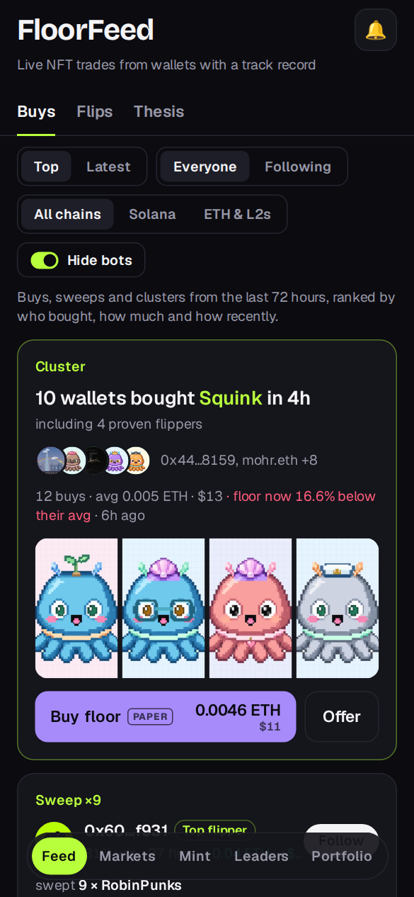
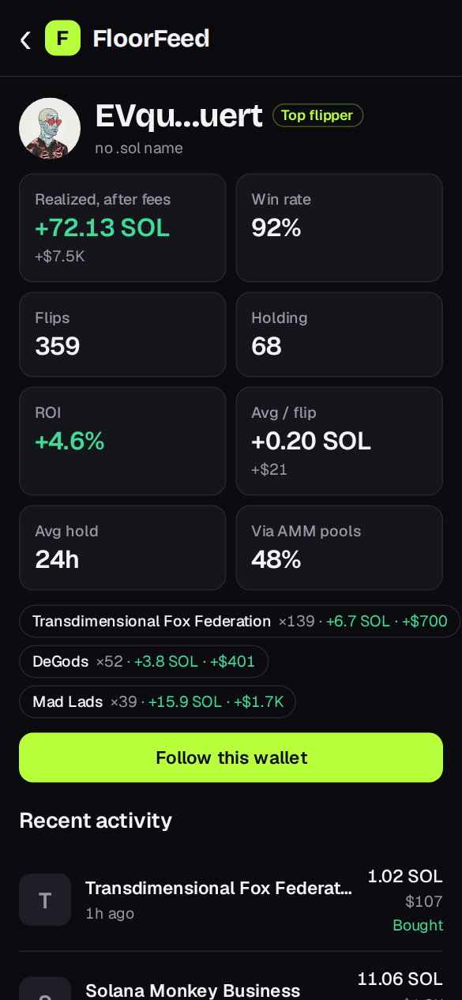
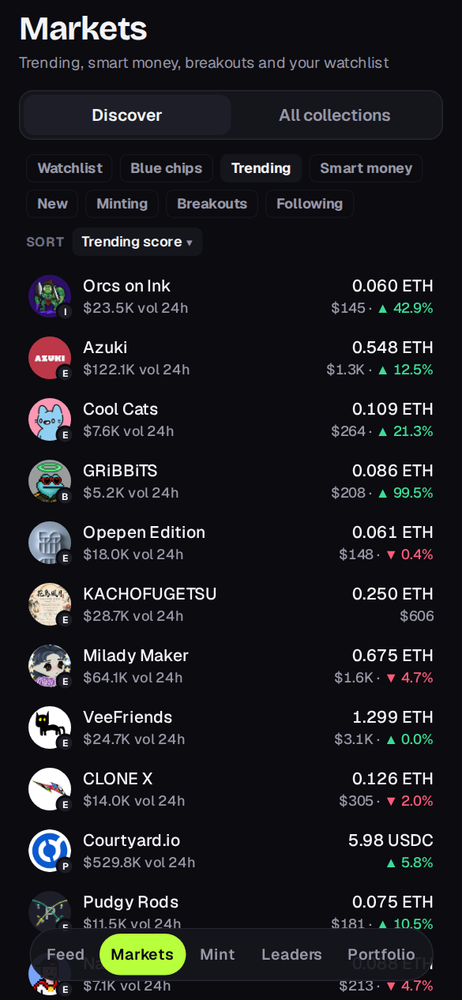
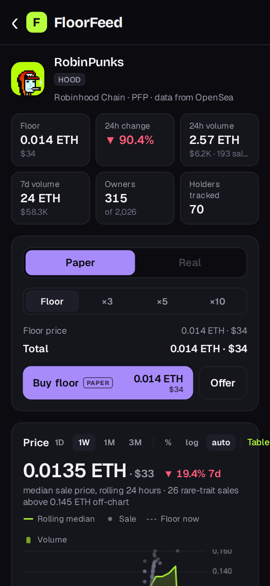
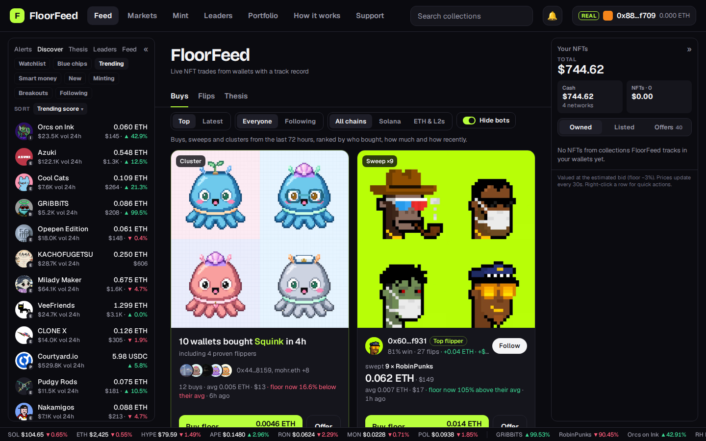
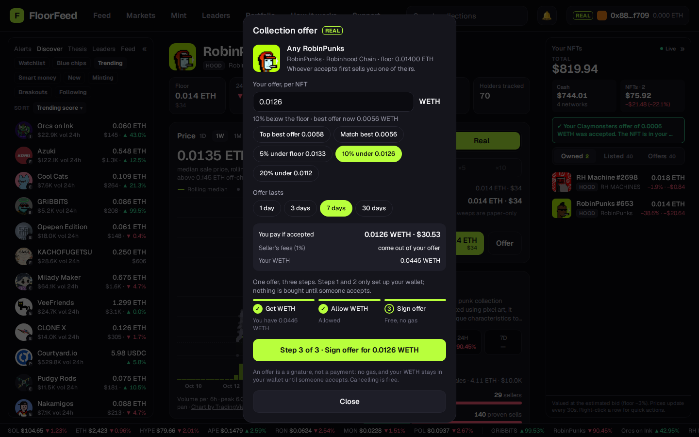
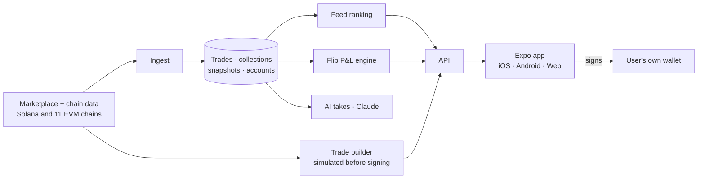

<div align="center">

# FloorFeed

**Follow the NFT traders who actually win, and trade alongside them.**

A live feed of what wallets with a real track record are buying, across Solana, Ethereum and ten more chains, with an AI read on each trade. Practice on paper, or buy, sell, list and make offers for real from your own wallet.

### [▶ Live: floorfeed.io](https://floorfeed.io)
<sub>Live mainnet data. One codebase: phone layout on mobile, multi-panel layout on desktop.</sub>


<table>
  <tr>
    <td align="center"><br/><sub><b>Feed</b>: proven wallets' buys, Buy floor or Offer</sub></td>
    <td align="center"><br/><sub><b>Leaders</b>: P&amp;L after fees, ROI, win rate</sub></td>
    <td align="center"><br/><sub><b>Wallet</b>: track record and activity</sub></td>
    <td align="center"><br/><sub><b>Portfolio</b>: practice or real, in dollars</sub></td>
  </tr>
  <tr>
    <td align="center"><br/><sub><b>Markets</b>: ~170 collections, 12 chains</sub></td>
    <td align="center"><br/><sub><b>Collection</b>: Trade box, price chart, depth</sub></td>
    <td colspan="2"></td>
  </tr>
</table>

<br/>
<sub><b>Desktop</b>: Discover panel, the feed, and Your NFTs with your total, cash and NFTs always in view</sub>

 

</div>

---

> **About this repository.** FloorFeed's application code (app and API) is private. This repository is the public face of the project: what it does, how it's built, and the **launchpad smart contracts**, which are open source so anyone can verify what they mint against. Investors and partners can request source access for due diligence via [mycodedojo.com](https://mycodedojo.com) or [@FloorFeed](https://x.com/FloorFeed).

## Why this exists

Social trading apps like FOMO made memecoin trading feel like a social feed: you see what good traders buy, follow them, and copy a trade with one tap. They work because **every trade is public on-chain**, so a trader's track record can be checked.

NFT trading has the same public data, but no product like this existed for it. FloorFeed is that product.

## What you can do

| | |
|---|---|
| **Feed** | Buys, sweeps and clusters from wallets with a proven record, profitable flips, and holders' theses. Filter by chain, by who you follow, and hide market-making bots. Every buy card ends in **Buy floor** and **Offer** |
| **Discover & Markets** | Watchlist, blue chips, trending, smart money, new and minting collections, breakouts; dollar values next to every coin amount |
| **Collections & NFTs** | Price chart with volume, floor depth, holders, sales, flippers, rarity ranks and trait shares |
| **Leaders & wallets** | Flip P&L after fees, ROI, win rate, hold time, streaks, market-maker detection |
| **Practice mode** | Trade at live prices with no wallet, with weekly practice seasons and a leaderboard |
| **Real trading** | Buy listings, sell into the best offer, list, make item and collection offers, cancel for free, all from your own wallet; in-app Solana buys |
| **Money** | Balances on every network, move and swap between networks, card deposits, send |
| **History** | Every buy, sale, listing and offer with its outcome; CSV export |
| **Launchpad** | Create and mint your own PFP collection on Ethereum, Base or Robinhood Chain ([contracts](contracts/README.md)) |
| **Alerts** | Follow wallets and get their trades in an inbox and as push notifications |

## How NFTs change the design

NFTs aren't interchangeable the way tokens are, so a straight copy of a token social-trading app doesn't work:

| | Token app | FloorFeed |
|---|---|---|
| **Copy a trade** | Buy the same token | Buy the **collection floor**, or **offer** under it, because the exact NFT is already sold |
| **Exit** | Sell into the pool's liquidity | **Sell into the best offer** (item, trait or collection), or list at your price |
| **Unrealized P&L** | Token price × size | Marked at the **estimated bid, not the floor**. The floor is what sellers ask, not what you'd get |
| **Trader score** | P&L on a token | P&L on **flips**, after marketplace fees and royalties |

## Non-custodial by design

FloorFeed never holds your funds or your keys. You sign every transaction in your own wallet (a browser extension, or an embedded wallet you control after signing in with email or Google). Before your wallet ever sees a transaction, FloorFeed simulates it against the chain as you, so a listing that just sold or a short balance is caught without costing gas. Listings and offers are standard OpenSea Seaport orders signed as typed data.

## Architecture



## Tech stack

| Layer | Choice |
|---|---|
| App | Expo, React Native, React 19, Expo Router, TradingView Lightweight Charts (web), PWA |
| Server | Node 22, Fastify, SQLite, viem |
| Wallets | Wallet Standard / EIP-6963 extensions, Privy (email / Google sign-in, embedded Solana and EVM wallets, card funding) |
| Markets | OpenSea Seaport, Magic Eden, Tensor, Helius, Relay |
| AI | Anthropic Claude, with a local model as fallback |
| Contracts | Foundry: `FloorFeedDrop` (ERC-721 clones), `FloorFeedFactory` (CREATE2), `FloorFeedStore` (SSTORE2) |

## Launchpad contracts

The contracts behind FloorFeed's launchpad live in [`contracts/`](contracts/README.md), with tests, deploy scripts and every deployed address. They're deployed at the same addresses on Ethereum, Base and Robinhood Chain, and Sourcify-verified on Ethereum and Base.

```bash
cd contracts
# fetch the pinned dependencies listed in contracts/README.md, then:
forge test
```

---

<div align="center"><sub>Built by <a href="https://mycodedojo.com">Michael Cooper</a> · <a href="https://floorfeed.io">floorfeed.io</a> · <a href="https://x.com/FloorFeed">@FloorFeed</a></sub></div>
